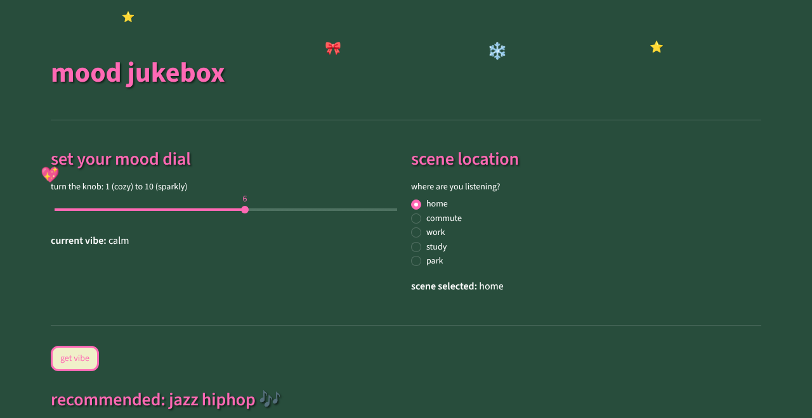

# mood jukebox

A small Streamlit app that picks music for your mood. Turn the mood dial, choose where you're listening, and it recommends a genre (city pop, jazz hip-hop, study focus or ambient jazz) and plays a matching track.



*The screenshot uses fallback fonts. The live app uses the hand-drawn Indie Flower font.*

## How it recommends

The rules live in [`jukebox.py`](jukebox.py), separate from the UI so they can be tested:

| Scene | Mood at or above threshold | Below threshold |
|---|---|---|
| commute (threshold 5) | city pop | jazz hip-hop |
| work / study (threshold 6) | study focus | jazz hip-hop |
| park (threshold 6) | city pop | jazz hip-hop |
| home (threshold 6) | jazz hip-hop | ambient jazz |

For any other scene, it goes by mood alone: 8 and up is city pop, 5-7 is jazz hip-hop, and lower is ambient jazz.

## Run it

```bash
pip install -r requirements.txt
streamlit run app.py
```

Tests: `pip install -r requirements-dev.txt && pytest`

Built with Python and Streamlit by [Xinyang Ma](https://github.com/hakowxy).
